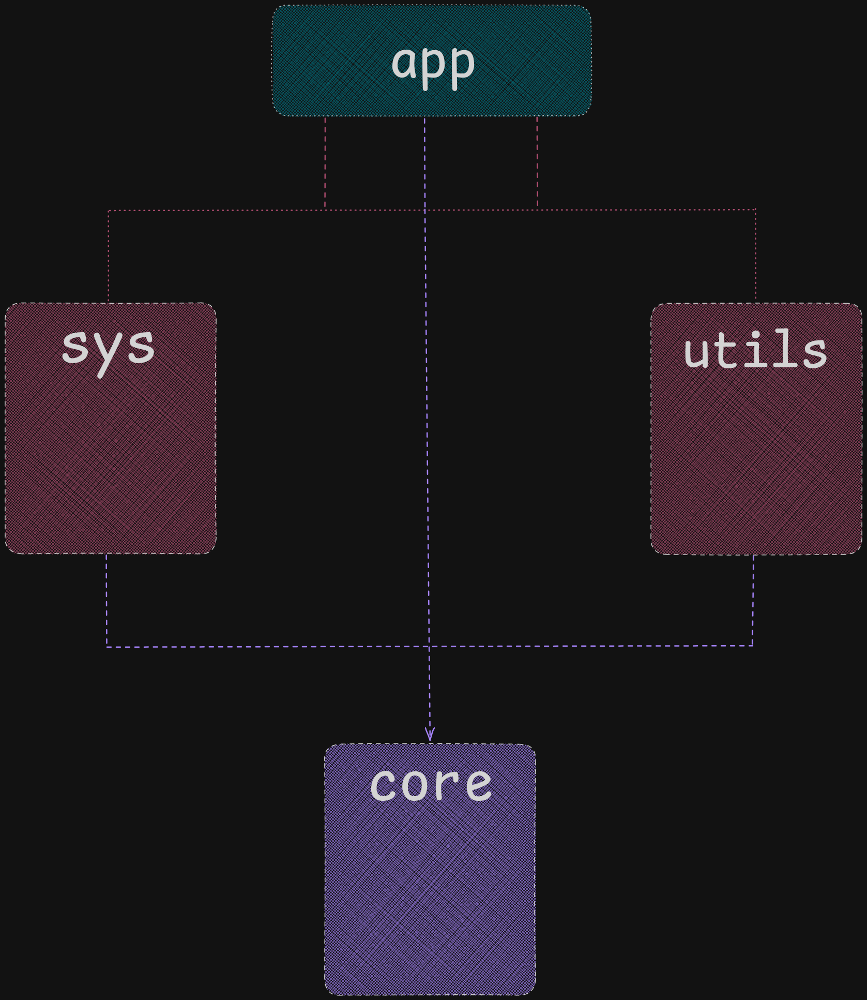

## Сборка

Для сборки приложения необходима система сборки CMake (я использовал генератор Ninja).

```
cmake -G Ninja -B build -DCMAKE_EXPORT_COMPILE_COMMANDS=ON
```

Эта команда может занять пару минут (на моей машине это требовало порядка 3-х минут), так как она устанавливает все необходимые зависимости через FetchContent.

```
cmake --build build --parallel
```

После сборки в директории `build/scr/app` появятся три исполняемых файла : `server, client, stats`.

Для запуска тестов необходимо перейти в директорию сборки и вызвать ctest :

```
cd build && ctest
```

---

## Запуск

---

### Сервер

Серверу при запуске передаются два аргумента : путь к конфигу с паттернами и номер порта для прослушивания

например допустим у нас есть конфигурационный файл `config.json` :

```
[
  {"identifier_": "Ugroza.RmRf", "pattern_": "rm - rf /"},
  {"identifier_": "Love.Letter", "pattern_": "ILOVEYOU"}
]
```

Сервер работает до получения сигнала завершения. При получении сигнала он дожидается завершения всех дочерних процессов и освобождает все ресурсы.

---

### Клиент

Клиетну передается путь к файлу для проверки и номер порта сервера :

```
./build/src/app/client /.../path_to_file.txt <port>
```

Клиент отправляет файл на сервер, получает результат проверки и выводит его в консоль.

---

### Статистика

Для статистики запускается отдельная утилита отдельным процессом. Она подключается к работающему серверу через fifo (именованные каналы) и запрашивает текущую статичтику.

```
./build/src/app/stats
```

---

## Зависимости

Приложение зависит от трех внешних библиотек : `nlohmann::json, spdlog, GTest`.

---

## Архитектура приложения

Сразу предупрежу, что на построение архитектуры я потратил больше всего времени. Этим вызвано странное деление на поддиректории внутри src. Однако я обосновываю это тем, что действительно понравилась таска и я подумал над тем, что этот проект мог бы стать отличной песочницей для моих пет-проектов (в частности, у меня есть свой самописный асинхронный фреймворк и мне захотелось после сдачи таски попробовать запустить ту же самую проверку файлов, но обрабатывать клиентов не в отдельном процессе, а например в моей корутине или фьюче внутри тред пула. а также абстрагироваться от механизма взаимодействия, не ограничиваться пайпами и попробовать mmap или channel). Этим вызвано, что у меня присутствуют два абстрактных класса, которые абстрагируют единицу исполнения (ISpawner) и механизм взаимодействия этих единиц исполнения (IResultSink). на конечную реализацию это не влияет (за исключением парочки виртуальных вызовов), процессная реализация с пайпами просто реализует эти интерфейсы

Я разделил приложение на 4 слоя. Верхние слои зависят от нижних.




Слой core содержит базовые сущности и интерфесйы, которые используют все остальные слои приложения

Слой utils отвечает за сериализацию/десериализацию сущностей из слоя core, а также за форматированный вывод этих сущностей в консоль.

Слой sys содержит все необходимые RAII обертки над системными ресурсами

Слой app содердит три точки входа для всех трех частей приложения. Он не содержит внутреннюю логику и системные детали, а делегирует это низжим слоям. получается красиввая декомпозиция.

---

### КАК Я наконец-то разобрался с магическим epoll

Несмотря на то, что наше приложение работающее в отдельных процессах нельзя назвать шибко расширяемым, нам все же нужен какой-то способ эффективно обрабатывать события из нескольких источников одновременно. новые соединения, результаты сканирования и запросы статистик от утилиты.

Я давно слышал про epoll и магию вокруг него, так что решил пощупать его на практике. Понимаю, что для нашего случая подошел бы старенкий poll, но мой интерес победил в данном случае.

В итоге я в какой-то момент понял, что внутри моего приложения потихоньку образовывается мини-boost::asio. В очередной раз спасибо за интересную таску:)

---

### IPC

Обмен статистикой между процессами реализован через ДВА именнованных пайпа. Изначально я попробовал что-то изобрести на одном пайпе, но быстро понял, что это не сработает, ведь если сервер и читает из пайпа и пишет в него, он можеи прочитать собственное сообщение. Поэтому я использовал два FIFO-пайпа : `request` и `responce`. Утилита статистики записывает один байт в `request` (чего достаточно, чтобы разбудить epoll сервера, тк ему нужен сам факт записи). Сервер, получив событие на `request`, сериализует статистику в json и и записывает в `responce`.

Fifo-пайпы создает и удаляет только сервер через FiFoGuard

Больше всего у меня времени при дебаге ушло на неблокирующее чтение. Сервер запускался, парсил конфиг и падал без всяких признаков ошибки. проблема была как раз в блокирующем чтении.

---

### Сигналы

для обработки я нашел интересную функцию std::signal из стандартной библиотеки
